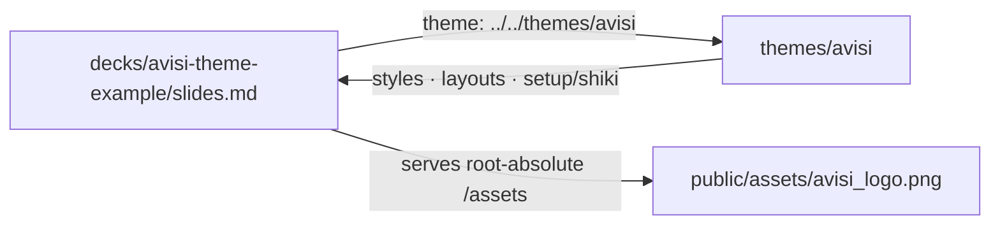

# Deck: avisi-theme-example

The Avisi theme playground as a deck (moved out of the theme package, decided 2026-11-08) — the
visual test bench for [`themes/avisi/`](../../themes/avisi/summary.md), not a real presentation.
Self-contained under `decks/avisi-theme-example/`: `slides.md` + `public/`. Related:
[../../practices.md](../../practices.md), [../../terminology.md](../../terminology.md),
[../welcome-to-slidev/summary.md](../welcome-to-slidev/summary.md).

## Global frontmatter

`theme: ../../themes/avisi` — local path **relative to the entry file**; this is the canonical way
decks consume the local theme (dev-server verified 2026-11-08) · `title: Avisi Theme Demo` ·
`comark: true` (the `{.avisi-subtitle}` demos need it). No `fonts:` block — the theme's
`slidev.defaults` (Poppins/Fira Code) apply.

## Slide inventory (8 slides)

| # | Topic | Feature exercised |
|---|-------|-------------------|
| 1 | Migration demo title | `default` layout, Comark subtitle (`{.avisi-subtitle}`) |
| 2 | Cover with logo | `cover` layout + `avisi-fancy`, deck-owned `public/` logo via root-absolute `` |
| 3 | Title/subtitle anatomy | `avisi-white-with-footer`, link/list-marker colors, borderless table |
| 4 | Comark subtitle | explicit `{.avisi-subtitle}` vs. unclassed `h2` (normal dark-blue heading) |
| 5 | Fancy background | `avisi-fancy-with-footer`, white text by default (no per-element styles) |
| 6 | Split slide | `two-cols` + `layoutClass: avisi-half-gray gap-8` |
| 7 | Code | Shiki `dark-plus` via the theme's `setup/shiki.ts`, 0.65em `pre` |
| 8 | Typography ladder | h4→h3→h2→h1 sizes × `--avisi-font-scale` |

## Invariants

- When a theme feature is added or changed, add/extend a slide here — the playground is the theme's
  living documentation and its visual test (verify via PDF export, see practices → Verification).
- The cover logo is ``, resolved against the **deck's** served
  root: this deck owns `public/assets/avisi_logo.png`; the theme has no `public/` (its `assets/`
  copy is CSS-only, referenced via relative `url(../assets/…)`).
- Subtitle style = the explicit Comark class only (the `h1 + h2` path was removed) — slide 4
  demonstrates both the classed and unclassed h2.
- Run via the dev-server skill: `pnpm exec slidev decks/avisi-theme-example/slides.md`.
