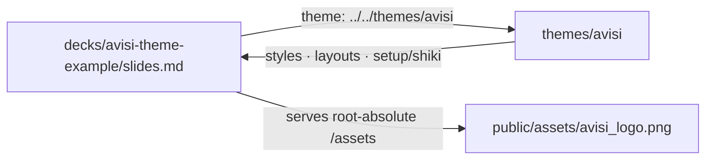

# Deck: avisi-theme-example

The Avisi theme demo deck (moved out of the theme package, decided 2026-11-08; restructured into a
tidy one-feature-per-slide test bench, decided 2026-11-08) — the visual reference for
[`themes/avisi/`](../../themes/avisi/summary.md), not a real presentation. Self-contained under
`decks/avisi-theme-example/`: `slides.md` + `public/`. Related:
[../../practices.md](../../practices.md), [../../terminology.md](../../terminology.md).

## Global frontmatter

`theme: ../../themes/avisi` — local path **relative to the entry file**; this is the canonical way
decks consume the local theme (dev-server verified 2026-11-08) · `title: Avisi Theme Demo` ·
`author: Dirk Groot` · `comark: true` (the `{.avisi-subtitle}` demo needs it) · `layout: cover` +
`class: avisi-fancy` — the headmatter doubles as slide 1's frontmatter, and slide 1 **is** the cover,
so no `layout: default` forcing is needed (removed in the 2026-11-08 restructure). No `fonts:` block
— the theme's `slidev.defaults` (Poppins/Fira Code) apply.

## Slide inventory (7 slides, one theme feature-cluster each)

| # | Topic | Frontmatter | Feature exercised |
|---|-------|-------------|-------------------|
| 1 | Cover (logo + title) | headmatter: `layout: cover`, `class: avisi-fancy` | `cover` layout, fancy bg, deck-owned white wordmark logo, `.emphasis` title |
| 2 | Typography ladder | `class: avisi-white-with-footer` | h1→h4 sizes at 2.5/1.6/1.3/1.0em × `--avisi-font-scale`, Poppins |
| 3 | Subtitle contrast | `class: avisi-white-with-footer` | `## … {.avisi-subtitle}` (bold dark gray) vs. unclassed `h2` (dark blue) |
| 4 | Lists, links & tables | `class: avisi-white-with-footer` | light-blue links (no underline) + `li::marker`, dark-gray body, borderless table — concise-but-nontrivial three-row table exercising left-aligned cells and the shrink-wrapped (content-minimum) table width |
| 5 | Code | `class: avisi-white-with-footer` | fenced `ts` block, Shiki `dark-plus` via the theme's `setup/shiki.ts`, 0.65em `pre` |
| 6 | Dark background | `class: avisi-fancy-with-footer` | white text by default (zero inline styles), footer logo on dark |
| 7 | Split | `layout: two-cols`, `layoutClass: avisi-half-gray gap-8` | `two-cols` + half-gray split via `layoutClass`, `gap-8` column gap |

## Invariants

- Every slide carries a theme-provided background class (decided 2026-11-08): plain content slides
  use `avisi-white-with-footer` — the theme's only generic light background — while the dark
  (`avisi-fancy*`) and split (`avisi-half-gray`) classes are demoed on their dedicated slides. A
  new playground slide must pick one of the four.
- Every slide demos the theme's **Reveal-parity centering** (added 2026-11-08): content is centered
  on both axes by default (`safe center` + `text-align: center`); `pre` stays left-aligned; opt out
  with `avisi-top-left`.
- Deck-wide rule: **one feature-cluster per slide, no meta-commentary slides** (decided 2026-11-08,
  restructure) — the deck demos theme features only; it does not demo the `src:` shared-slides
  pattern (that lives in [../../shared/summary.md](../../shared/summary.md), which was removed from
  this deck in the restructure) or migration history. Dev-rationale comments stay in the .lode and
  theme CSS, not in slide markup.
- When a theme feature is added or changed, add/extend a slide here and keep the one-feature-per-slide
  shape — the deck is the theme's living documentation and its visual test (verify via PDF export,
  see practices → Verification; PDF-export verified after the 2026-11-08 restructure).
- The cover logo is ``, resolved against the **deck's** served
  root: this deck owns `public/assets/avisi_logo.png`; the theme has no `public/` (its `assets/`
  copy is CSS-only, referenced via relative `url(../assets/…)`).
- `layout: cover` always pairs with `class: avisi-fancy` — `avisi_logo.png` is a **white** wordmark.
- Subtitle style = the explicit Comark class only (the `h1 + h2` path was removed) — slide 3
  demonstrates the classed subtitle and the unclassed plain `h2` side by side.
- Run via the dev-server skill: `pnpm exec slidev decks/avisi-theme-example/slides.md`.
