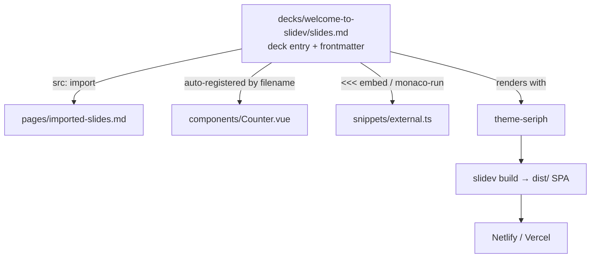

# Deck: welcome-to-slidev

Deck #1 — the stock Slidev starter showcase. Lives at `decks/welcome-to-slidev/` (self-contained: `slides.md` +
`pages/` + `components/` + `snippets/`). Related: [../../practices.md](../../practices.md),
[../../terminology.md](../../terminology.md).

## Global frontmatter (applies to whole deck)

`theme: seriph` · `background: https://cover.sli.dev` (random Unsplash) · `title: Welcome to Slidev` ·
`class: text-center` · `drawings.persist: false` · `transition: slide-left` (default; individual slides
override, e.g. `fade-out`, `slide-up`) · `comark: true` · `duration: 35min`.

## Slide inventory (starter showcase)

| # | Topic | Technique demonstrated |
|---|-------|------------------------|
| 1 | Welcome to Slidev | cover, `$slidev.nav` click-to-advance, icon buttons, notes |
| 2 | What is Slidev? | slide-scoped `<style>` gradient heading, `fade-out` transition |
| 3 | Navigation | keyboard-shortcut table, `v-click`/`v-after` absolute image |
| 4 | Table of contents | `two-cols` layout + `<Toc/>` component |
| 5 | Code | TwoSlash block with line-highlight steps `{all|4|6|6-7|9}`, `<arrow v-click>`, external snippet `<<< @/snippets/external.ts#snippet` |
| 6 | Shiki Magic Move | four-backtick `magic-move` container, `level: 2` |
| 7 | Components | `components/Counter.vue` auto-registration, built-in `<Tweet/>` |
| 8 | Themes | side-by-side theme screenshots, `class: px-20` |
| 9 | Clicks Animations | `v-click` modifier matrix, `v-mark` inline marks (Rough Notation) |
| 10 | Motions | `v-motion` directives + slide-local `<script setup>` (`@vueuse/motion`) |
| 11 | LaTeX | inline/block KaTeX with click steps `$$ {1|3|all}` |
| 12 | Diagrams | 4-up grid: 2× mermaid, mindmap, plantuml `{scale: 0.7}` |
| 13 | Draggable Elements | `v-drag` + `dragPos` frontmatter (`square: 691,32,167,_,-16`), `v-drag-arrow` |
| 14 | Imported Slides | `src: ./pages/imported-slides.md` splice |
| 15 | Monaco Editor | `{monaco}` and `{monaco-run}` blocks importing `snippets/external.ts` |
| 16 | Learn More | `center` layout closing links, `<PoweredBySlidev/>` |

## Invariants

- A line `---` on its own separates slides; the first frontmatter block is **global** config, subsequent ones
  are per-slide.
- Slide numbering is positional — inserting/removing a slide shifts every later slide (click-step references
  and `v-mark="7"` numbers are positional too).
- Components referenced in markdown must exist in this deck's `components/` with matching filename.
- All deck-internal references (`src:`, `<<< @/snippets/...`) resolve relative to the deck directory — the deck
  is relocatable as a unit.
