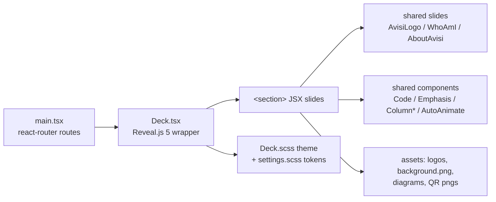

# Source repo: dirkgroot/presentations (Reveal.js era)

Architecture of <https://github.com/dirkgroot/presentations> — the migration **source**. Facts
recorded 2026-11-08 from a clone on `main`. Related: [summary.md](summary.md),
[feature-mapping.md](feature-mapping.md), [../terminology.md](../terminology.md).

## Stack

- **React 19 + Vite + react-router 7**: the SPA is a deck switcher; each presentation is a React
  component, routed at `/slug` (plus `/slug/scroll` variants that enable Reveal's scroll view;
  DDD also has a `/deep-dive-ddd/short` variant driven by a `shortVersion` prop).
- **Reveal.js 5.1 as a library** (not HTML slides): a shared [`Deck` wrapper component] mounts
  Reveal into a div and renders `<section>` children as slides. Slides are JSX.
- Code highlighting: highlight.js, **ir-black** SCSS theme. Fonts: **Poppins** 400/600 via
  `@fontsource/poppins`. Styling: SCSS modules. PDF export: **decktape** (exposed via
  `window.Reveal`). Diagrams: `mermaid` + `@lightenna/react-mermaid-diagram`. QR codes:
  `react-qr-code` (3 decks) or PNG images (FpOopBFFs).

## `Deck` config (applies to every presentation)

`width: 1920`, `height: 1280` (**3:2** canvas) · `transition: fade`, speed `fast`,
`backgroundTransition: none` · controls/progress/slideNumber **off** · `hash: true` ·
`pdfSeparateFragments: false` · plugins: highlight, notes, math · `document.title` set to
`"<title> | Dirk Groot"`.

## Presentation inventory (`src/presentations/`)

| Component | Size (lines) | Notable features |
|---|---|---|
| `AoC2025/AoC2025` | 63 | Dutch content; fragments; RightHalfGray background; no title/whoami slides |
| `GettingBetterAgainstAllOdds` | 119 | Shared WhoAmI slide; **AutoAnimate** across the case-study slides; Fancy title slide |
| `FpOopBestFriendsForever/FpOopBestFriendsForever` | 127 | QR **PNG** images; Light theme |
| `UnitTestingAndArchitecture/UnitTestingAndArchitecture` | 304 | `react-qr-code`; triangular-architecture image |
| `NeuralNetworkFromScratch/NeuralNetworkFromScratch` | 584 | Many PNG/SVG diagrams; tables; QR; math |
| `DeepDiveDomainDrivenDesign/DeepDiveDomainDrivenDesign` | 638 | Mermaid domain-model diagram; `shortVersion` prop trims slides; QR; book covers |
| `DesigningWithTypesKotlin` | 774 | Kotlin code w/ line-number fragments; **4-step Mermaid dev-workflow** (stacked via `.stack` grid trick); Giphy **iframes**; tables |
| `DesigningWithTypesJava` | 796 | Java twin of the Kotlin deck (same structure) |

## Shared building blocks

- **Slides** (`src/slides/`): `AvisiLogoSlide` (deck opener: Avisi logo on FancyBackground),
  `WhoAmISlide` ("$ whoami" personal intro), `AboutAvisiSlide` (company intro, two columns + photo).
- **Components** (`src/components/`): `Deck` (Reveal wrapper), `Code` (pre/code w/ `data-trim`,
  `data-line-numbers`, kotlin/java), `Emphasis` (light-blue **punctuation span** — headings end in
  a colored `.`), `ColumnLayout`/`Column` (flex columns, `flex` weight, vertical centering),
  `AutoAnimate` (tags siblings with Reveal `data-auto-animate` attrs), `Backgrounds` (enum below).
- **Styling**: `settings.scss` holds all Avisi tokens; `Deck.scss` is a custom white Reveal theme
  (Poppins, dark-blue headings, light-blue links + `li::marker`, no table borders, `pre` at 0.65em);
  `Presentation.module.scss` per-deck helpers: `.title` (2.75em h1), `.subtitle` (gray),
  `.stack` (children stacked on one grid cell — used to layer Mermaid workflow variants),
  `.drop-shadow`, `.frame`.

## Avisi branding tokens (`settings.scss`)

background `#f8f8f8` · dark blue `#003345` (headings) · light blue `#1199bb` (links, bullets,
Emphasis) · dark gray `#595959` (body) · light gray `#eee` · font scale 0.95. Footer: Avisi logo
bottom-left (height 3% of slide, margin 2%). `Backgrounds` enum composites: `FancyBackground`
(`public/assets/background.png` cover), `FancyWithFooter` / `WhiteWithFooter` (logo + white-ish
gradient), `RightHalfGrayWithFooter` (right half `#eee`).

## Invariants of the source layout

- Every public deck opens with `AvisiLogoSlide`; most then show `WhoAmISlide`.
- Headings end with an `Emphasis`-wrapped punctuation mark (`.`/`?`/`!`) — the deck's visual signature.
- Reveal **fragments** (`className="fragment"`) are the only animation mechanism (plus AutoAnimate).
- Slide backgrounds are always one of the `Backgrounds` enum values, set via `data-background`.
- Content language is English except `AoC2025` (Dutch).
