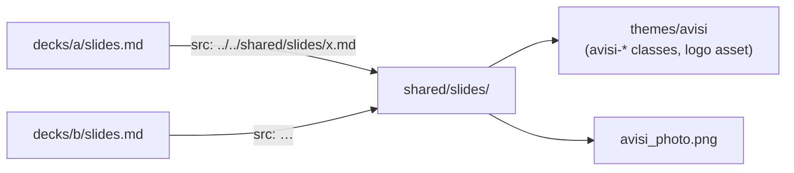

# Shared slides (cross-deck reusable)

Reusable slides shared by multiple decks, at `shared/slides/` — the Slidev port of the source repo's
shared slide components `src/slides/` ([../migration/reveal-source-repo.md](../migration/reveal-source-repo.md)).
Decided 2026-11-08 (cross-deck referencing requested; see [../plans/migration-poc.md](../plans/migration-poc.md)).
Related: [../practices.md](../practices.md) → Repo layout, [../themes/avisi/summary.md](../themes/avisi/summary.md).

## Inventory

| file | ported from | slide look |
|---|---|---|
| `avisi-logo.md` | `AvisiLogoSlide` | white Avisi logo, centered, on `avisi-fancy` (`layout: cover`) |
| `whoami.md` | `WhoAmISlide` | "$ whoami_" intro, bullet-less list, `avisi-white-with-footer` |
| `about-avisi.md` | `AboutAvisiSlide` | "Avisi?" title centered above two columns (`two-cols-header`: bullet-less list + office photo), `avisi-white-with-footer` |

`avisi_photo.png` (1415×1533) sits next to `about-avisi.md`, copied from the source clone
(`src/slides/avisi_photo.png`). The logo is **not** duplicated here — `avisi-logo.md` references the
theme asset directly, keeping `themes/avisi/assets/` the single source of the logo.

## Consumption

A deck splices a shared slide in with a `src:` frontmatter import (one slide separator per import):

```md
---
src: ../../shared/slides/whoami.md
---
```

- `src:` resolves **relative to the importing file**; a range suffix (`file.md#2,5-7`) selects
  slides — with one file per slide, ranges are unnecessary.
- `src:` **on the first separator works together with the global headmatter** (verified slidev
  53.1.0, `decks/fp-oop-bffs/`): `theme:`/`title:`/… and `src:` on the same opening block import
  the shared slide as slide 1 while the other keys stay deck config. The imported slide keeps its
  own frontmatter (`layout: cover`, `class: avisi-fancy`).
- The parser allows imports anywhere under the pnpm workspace root
  (`allowedRoots = [userWorkspaceRoot, userRoot]` in `@slidev/parser`), so `../../shared/…` from
  `decks/<name>/` is legal — together with `theme:`, a sanctioned exception to deck
  self-containment.
- Imported slides **keep their own per-slide frontmatter** (`layout`, `class`); the importing
  separator's frontmatter (minus `src`) merges over it, so a deck can override if needed.
- Shared slides assume the consuming deck runs the `themes/avisi` theme (they use its `avisi-*`
  classes and assets).

## Authoring rules for shared slides

- **Assets: markdown image syntax only** (``) — Vite resolves it relative to the md
  file (dev serves `/@fs/…`; build emits a hashed asset — both verified). Raw HTML
  `` resolves against the **consuming deck's** served root and would 404 from a
  sibling deck.
- **Per-slide styling: slide-scope `<style>` blocks**, selectors keyed on a dedicated slide class
  carried in the slide's own frontmatter (`class: avisi-whoami-slide` → `.avisi-whoami-slide ul`),
  so rules stay slide-local and harmless even if slide-style scoping ever regressed to global.
  Used for the bullet-less lists (`list-style: none`) and image sizing (logo 35% width, About photo
  `max-height: 320px`).
- **Size tall images with a canvas-px `max-height` cap** (2026-11-08, About Avisi photo): Reveal's
  core `img { max-width: 95%; max-height: 95% }` was not ported to the theme — in the theme's flex
  layouts a percentage `max-height` resolves against a content-driven (indefinite) column height and
  is silently ignored, so uncapped images render at column width × natural aspect. On the 16:9
  canvas that made the About photo ~81% of the slide height: it ran into the footer band and the
  whole block overflowed (`safe center` fell back to top-pinning, title jammed against the top
  edge). The fix is a px cap in the slide's keyed style (`.avisi-about-slide .col-right img` — px
  are canvas px, the canvas scales as a whole); the cap keeps the block centered and clear of the
  footer band (photo spans ~27–85%, band top at 93%). Note the trade-off vs the source: Reveal's
  4:3-ish canvas let the photo be both relatively wide and tall; on 16:9 the photo is relatively
  smaller than the original's.
- **No UnoCSS classes in shared files** (verified slidev 53.1.0): `list-none` on a shared slide's
  `<ul>` never generated (computed style stayed `square`) while identical markup in a deck-owned
  file works — Uno extraction misses `src:`-imported files. Use scoped styles instead.
- **No Comark syntax** — `comark: true` is a deck-level headmatter flag; shared slides must render
  in any consuming deck (use `<span class="emphasis">.</span>` HTML, not `{.avisi-subtitle}` attrs).
- **One named slot with an `` + a second named slot = broken one-piece PDF export** (verified
  slidev 53.1.0 with `about-avisi.md` as `two-cols-header`, 2026-11-08): in `slidev export`'s
  one-piece mode, a **src-imported** slide whose `::right::` holds a markdown image *and* that also
  uses another slot marker (`::left::`) renders **only the default slot** — both named slots come up
  empty, silently. One named slot alone is fine; two named slots with text only are fine; inline
  (non-src) slides are fine; the dev server (hot or cold) is fine. Same family as slidevjs/slidev#2588
  (named-slot imgs vanish in one-piece export). **Workaround: export with `--per-slide`** (verified —
  still produces one merged PDF) or the browser exporter at `localhost:<port>/export`. The About
  slide keeps `two-cols-header` under this workaround.
- Prefer markdown lists per repo convention, **except** marker-less lists: a raw `<ul>` is fine
  there (items are HTML-only, so nothing markdown is lost) — a class can't ride on a markdown list
  without Comark/Uno anyway.



## Invariants

- One file per shared slide, kebab-case, in `shared/slides/`. The file's leading frontmatter is the
  slide's frontmatter (a shared file is never a deck entry, so it has no headmatter of its own).
- Shared slides carry their finished look — layout + background class + styling baked in; a deck
  adds nothing but the `src:` separator.
- Verified 2026-11-08 (slidev 53.1.0, deck `decks/avisi-theme-example/` as consumer): dev server
  DOM probe (layout classes, emphasis `#1199bb`, image natural sizes), PDF export visual check
  (centering, bullets, footer logo), and production build (hashed `avisi_logo-*.png` /
  `avisi_photo-*.png` load in the static SPA).
