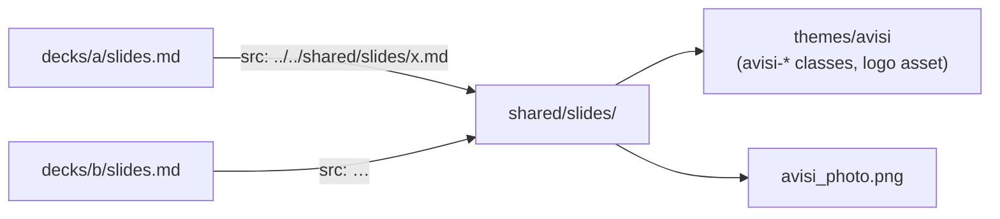

# Shared slides (cross-deck reusable)

Reusable slides shared by multiple decks, at `shared/slides/` — the Slidev port of the source repo's
shared slide components `src/slides/` ([../migration/reveal-source-repo.md](../migration/reveal-source-repo.md)).
Decided 2026-11-08 (cross-deck referencing requested; see [../plans/migration-poc.md](../plans/migration-poc.md)).
Related: [../practices.md](../practices.md) → Repo layout, [../themes/avisi/summary.md](../themes/avisi/summary.md).

## Inventory

| file | ported from | slide look |
|---|---|---|
| `avisi-logo.md` | `AvisiLogoSlide` | white Avisi logo, centered, on `avisi-fancy` (`layout: cover`) |
| `whoami.md` | `WhoAmISlide` | "$ whoami_" intro, bullet-less list, `avisi-white-with-footer` |
| `about-avisi.md` | `AboutAvisiSlide` | "Avisi?" two-cols + office photo, `avisi-white-with-footer` |

`avisi_photo.png` (1415×1533) sits next to `about-avisi.md`, copied from the source clone
(`src/slides/avisi_photo.png`). The logo is **not** duplicated here — `avisi-logo.md` references the
theme asset directly, keeping `themes/avisi/assets/` the single source of the logo.

## Consumption

A deck splices a shared slide in with a `src:` frontmatter import (one slide separator per import):

```md
---
src: ../../shared/slides/whoami.md
---
```

- `src:` resolves **relative to the importing file**; a range suffix (`file.md#2,5-7`) selects
  slides — with one file per slide, ranges are unnecessary.
- The parser allows imports anywhere under the pnpm workspace root
  (`allowedRoots = [userWorkspaceRoot, userRoot]` in `@slidev/parser`), so `../../shared/…` from
  `decks/<name>/` is legal — together with `theme:`, a sanctioned exception to deck
  self-containment.
- Imported slides **keep their own per-slide frontmatter** (`layout`, `class`); the importing
  separator's frontmatter (minus `src`) merges over it, so a deck can override if needed.
- Shared slides assume the consuming deck runs the `themes/avisi` theme (they use its `avisi-*`
  classes and assets).

## Authoring rules for shared slides

- **Assets: markdown image syntax only** (``) — Vite resolves it relative to the md
  file (dev serves `/@fs/…`; build emits a hashed asset — both verified). Raw HTML
  `` resolves against the **consuming deck's** served root and would 404 from a
  sibling deck.
- **Per-slide styling: slide-scope `<style>` blocks**, selectors keyed on a dedicated slide class
  carried in the slide's own frontmatter (`class: avisi-whoami-slide` → `.avisi-whoami-slide ul`),
  so rules stay slide-local and harmless even if slide-style scoping ever regressed to global.
  Used for the bullet-less lists (`list-style: none`) and image sizing (logo 35% width, photo
  column width).
- **No UnoCSS classes in shared files** (verified slidev 53.1.0): `list-none` on a shared slide's
  `<ul>` never generated (computed style stayed `square`) while identical markup in a deck-owned
  file works — Uno extraction misses `src:`-imported files. Use scoped styles instead.
- **No Comark syntax** — `comark: true` is a deck-level headmatter flag; shared slides must render
  in any consuming deck (use `<span class="emphasis">.</span>` HTML, not `{.avisi-subtitle}` attrs).
- Prefer markdown lists per repo convention, **except** marker-less lists: a raw `<ul>` is fine
  there (items are HTML-only, so nothing markdown is lost) — a class can't ride on a markdown list
  without Comark/Uno anyway.



## Invariants

- One file per shared slide, kebab-case, in `shared/slides/`. The file's leading frontmatter is the
  slide's frontmatter (a shared file is never a deck entry, so it has no headmatter of its own).
- Shared slides carry their finished look — layout + background class + styling baked in; a deck
  adds nothing but the `src:` separator.
- Verified 2026-11-08 (slidev 53.1.0, deck `decks/avisi-theme-example/` as consumer): dev server
  DOM probe (layout classes, emphasis `#1199bb`, image natural sizes), PDF export visual check
  (centering, bullets, footer logo), and production build (hashed `avisi_logo-*.png` /
  `avisi_photo-*.png` load in the static SPA).
